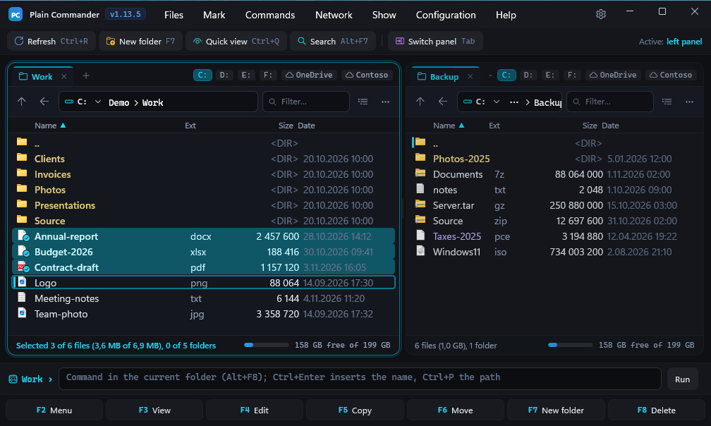

# Plain Commander

[](https://github.com/plain-browser/plain-commander/actions/workflows/build.yml)
[](LICENSE)


**A fast, keyboard-first, dual-pane file manager for Windows 11.**

Plain Commander follows the classic two-panel design: two folders side by side, the cursor and the marks on the
keyboard, every common action one key away (`F5` copy, `F6` move, `F7` new folder, `F8` delete). It is built as a
native WinUI 3 application with a modern, quiet look (graphite with a cyan accent, light and dark theme) and handles
archives, encrypted containers, FTP/SFTP/S3 servers, network shares, OneDrive, disk images, directory comparison and
bulk renaming in the same two panels, with the same keys.

It lists and sorts a folder of 100,000 entries in about half a second, runs long copies in a queue you can pause, and lets you undo
the last file operation with `Ctrl+Z`.



> **Status:** the application is in active development (current release: 1.13.x). It is usable every day, but it is
> not signed with a publicly trusted certificate yet; see [Installation](#installation).

---

## Contents

- [Highlights](#highlights)
- [Features](#features)
  - [Panels and navigation](#panels-and-navigation)
  - [Marking, searching and filtering](#marking-searching-and-filtering)
  - [File operations](#file-operations)
  - [Undo](#undo-ctrlz)
  - [Archives](#archives)
  - [Encryption](#encryption)
  - [Servers, network, OneDrive and disk images](#servers-network-onedrive-and-disk-images)
  - [Compare and synchronize](#compare-and-synchronize)
  - [Renaming many files](#renaming-many-files)
  - [Viewing, details and checksums](#viewing-details-and-checksums)
  - [Appearance and language](#appearance-and-language)
- [Keyboard reference](#keyboard-reference)
- [Installation](#installation)
- [Building from source](#building-from-source)
- [Architecture](#architecture)
- [Design decisions and scope](#design-decisions-and-scope)
- [Settings, logs and privacy](#settings-logs-and-privacy)
- [Contributing](#contributing)
- [License and third-party software](#license-and-third-party-software)

---

## Highlights

| | |
|---|---|
| **Two panels, tabs, one keyboard** | Tabs in each panel, drive buttons, favorites, directory history, quick search by any fragment of a name. Everything has a key; the mouse works too (drag and drop between panels and from/to Explorer). |
| **Operation queue** | Copy, move, delete, pack and unpack run in the background in a queue with progress, pause, cancel, per-file conflict choices ("overwrite / skip / keep both / only if newer", with "apply to all"), and retry/skip on errors. |
| **Undo (`Ctrl+Z`)** | Reverses copy, move, rename, Recycle Bin deletes, new files and folders, attribute changes, packing and encryption, after telling you exactly what will happen. Nothing is ever deleted for good or overwritten by an undo. |
| **Archives as folders** | 7z, zip, rar (including rar5 and multi-part), iso, cab, wim, tar, tar.gz, tar.zst, rpm, deb, dmg and more open like directories, with passwords. Write support for zip, 7z, tar and tar.gz. |
| **Own encryption format, `.pce`** | AES-256-GCM with an Argon2id key, authenticated, about disk speed (more than 700 MiB/s measured). Open an encrypted container like an archive: browse it, copy single files out. 7z and zip (AES-256) are available for other programs. |
| **Servers and clouds** | FTP, FTPS, SFTP and S3-compatible storage (Amazon S3, MinIO, Cloudflare R2, Wasabi, Backblaze B2) as ordinary folders, with resumable transfers. Local-network computers and shares, OneDrive (personal and work accounts) one click away. |
| **Compare and synchronize** | Directory compare with a diff view, two-way synchronization with a preview, text and binary file compare. |
| **Bulk rename** | Masks, counters, search and replace, case, transliteration to Latin letters, with a preview and undo. |
| **Light on resources** | Native code paths for the shell, background folder-size calculation, lazy details; no telemetry, no update checks, no background services. |

## Features

### Panels and navigation

- Two panels, each with its own **tabs**; the active panel is always obvious (cursor frame, accent line).
- **Full** and **brief** (multi-column) views, switchable per panel (`Ctrl+F1` / `Ctrl+F2`); compact rows; an
  optional attributes column; adjustable font and size.
- **Drive buttons** (`C:`, `D:`, …) on each panel, plus OneDrive and WSL buttons, the network and open servers in the
  `Alt+F1` / `Alt+F2` menu. Choosing the drive the other panel is on lands in its folder; otherwise a drive
  remembers the folder you were in on it.
- **Editable path bar** (`Ctrl+L`) with clickable breadcrumbs; type a local path, a UNC path
  (`\\server\share`) or a server address (`sftp://user@host/path`).
- **Favorites** (`Ctrl+D`), **history** (`Alt+Down`), "same folder in the other panel" (`Ctrl+Left` / `Ctrl+Right`),
  swap panels (`Ctrl+U`).
- **Command line** under the panels (`Alt+F8`): run a command in the current folder; `Ctrl+Enter` inserts the name
  under the cursor, `Ctrl+P` the path.
- Folders with 100,000+ entries open quickly; sorting by name, extension, date (modified or created), size.
- **Folder sizes** are calculated in the background (optional) and take part in size sorting.
- **Shell context menu** on right-click, and file properties (`Alt+Enter`).
- Drag and drop between panels (with `Shift` to move), into and out of Explorer.

### Marking, searching and filtering

- Mark with `Insert` / `Space`, by mask (`Num +` / `Num -`), invert (`Num *`), all (`Ctrl+A`); copy marked names or full
  paths to the clipboard (`Ctrl+Shift+C`).
- **Quick search**: just start typing. It finds a fragment *anywhere* in the name, ignoring case and diacritics
  (typing `zolc` finds "Żółć"), shows the number of hits and cycles through them with `Up` / `Down`. `Ctrl+S` keeps
  only the hits.
- **Filter** (`Ctrl+S`): name (several words or masks), extensions, modified or created date (today, last 7/30 days,
  this year, a range), size range, files only, photo taken date, media duration. `Ctrl+B` flattens a tree into one list.
  `Esc` removes the filter. Every panel also has a live filter box.
- **Search** (`Alt+F7`): by name and by content, with regular expressions, inside archives, results in a panel of their
  own ("send to panel").

### File operations

- **Copy, move, delete, rename, new folder, new file** with the classic keys; targets are proposed from the other
  panel.
- A **queue with progress cards**: pause, resume, cancel; the speed and time left; small files are copied in parallel
  (configurable), large files stream.
- **Conflict handling** per file or for all: overwrite, skip, keep both, overwrite only older; folder merge.
- **Recycle Bin** by default (`F8`); permanent deletion is explicit (`Shift+F8` / `Shift+Del`).
- **Run as administrator when needed:** if an operation hits "access denied" (for example in `Program Files`), the
  error offers "As administrator". The elevated helper is the same executable, talks over a verified pipe, and exits
  with the program or after ten idle minutes.
- Long paths (`\\?\`), read-only files, symbolic links and junctions are handled.
- **Attributes** and dates (read-only, hidden, system, archive, modified time) in one dialog; **permissions (chmod)**
  on SFTP/FTP servers, optionally recursive.
- Resumable transfers to and from FTP/SFTP: an interrupted upload or download is continued (automatic retries, a
  `.part` file stays after a cancel and the next copy finishes it).

### Undo (`Ctrl+Z`)

Every operation that can be reversed is remembered for the session (up to 50 steps). `Ctrl+Z` shows what will happen and
only then does it:

| Operation | Undo |
|---|---|
| Copy, unpack, pack, encrypt | Created files and folders go to the Recycle Bin (an empty folder is simply removed). |
| Move, rename (`Shift+F6`), bulk rename | Items return to their old place and name; source folders removed by the move are recreated. |
| Delete to Recycle Bin (`F8`) | Items are restored from the Recycle Bin, as Explorer's "Restore" does. |
| New folder (`F7`), new file (`Shift+F4`) | The new item disappears. |
| Attributes and dates | The previous values return. |

Undo never deletes permanently and never overwrites: if the place is taken or the item is gone, you are asked whether to
skip or retry, and the rest continues. Not undoable (and the dialog says so): the old content of overwritten files,
permanent deletes, operations on servers and inside archives, and operations done as administrator.

### Archives

- **Read:** 7z, zip, rar (rar5 and multi-volume), iso, cab, wim, arj, lzh, rpm, deb, dmg, tar, tar.gz, tar.zst, msi
  and many more, through the 7-Zip library. Enter walks into an archive like into a folder; `F3`, `F5` and search work
  inside.
- **`Ctrl+PgDn`** on a file tries to open it as an archive, which works for installers (exe, msi) and disk images.
  PDF and Office documents are deliberately not opened this way.
- **Write:** zip, 7z, tar, tar.gz (`Alt+F5`); inside zip, tar and 7z archives you can add (`F5` / `F6`), delete (`F8`),
  rename (`Shift+F6`) and create folders (`F7`).
- **Passwords:** encrypted archives ask for the password (again when it is wrong) and remember it until the program
  closes. 7z can be written with a password that also hides file names; zip uses AES-256.
- **Unpack** (`Alt+F9`): marked archives go to the other panel, each into a folder named after the archive.

### Encryption

*Files → Encrypt* (`Ctrl+E`) turns each marked file or folder into its own encrypted copy, in the folder you choose
(by default the other panel), and then offers to delete the originals.

**`.pce`: Plain Commander's own container** (default, needs nothing else installed):

- **AES-256-GCM**, authenticated, with a key derived from the password by **Argon2id** (64 MiB, 3 passes, 4 lanes);
  ChaCha20-Poly1305 is used on machines without AES hardware.
- The file is cut into 1 MiB blocks, each authenticated against the header; **truncation, reordering, appended data
  and bit flips are detected**. A wrong password is recognised immediately, before any data is read.
- The name, size, time and attributes of the original are stored inside; optionally the container gets a **random file
  name** so that even the name is hidden.
- **zstd compression** is applied before encryption only when a sample of the data says it pays (not for photos,
  video or archives); you can force it on or off.
- Fast: more than 700 MiB/s on a test machine, including key derivation.
- **Use:** `Enter` or `Ctrl+PgDn` on a `.pce` file and the password opens its content *like an archive*: walk through
  folders, copy single files or folders out with `F5`, `Backspace` returns to the folder holding the container.
  *Files → Decrypt* writes everything to disk. The password is remembered for the session, in memory only.
- `.pce` files are drawn in violet in the panels.

**7z and zip** are offered for exchange with other programs: AES-256, with 7z also hiding the names. (Plain Commander
never writes the weak legacy "ZipCrypto" and does not create rar archives.)

### Servers, network, OneDrive and disk images

- **FTP, FTPS and SFTP** (`Ctrl+F` opens the connection list, or type `sftp://user@host` in the path bar). A server
  folder behaves like a local one: view (`F3`), edit (`F4`, with a "send it back?" question after saving), copy and
  move both ways, create, delete, rename. Passwords are stored in the Windows Credential Manager only if you tick
  "remember"; the server's host key fingerprint is shown on first connection and a change is clearly warned about.
- **S3-compatible storage:** Amazon S3, MinIO, Cloudflare R2, Wasabi, Backblaze B2; buckets are top-level folders.
- **Local network:** computers on the network, their shared folders and the files in them (`Alt+F1` → *Network*);
  typing `\\server` opens that server's shares; the Windows credential prompt appears when a share needs a login.
- **OneDrive:** your personal and work or school OneDrive folders appear as buttons next to the drives and in the drive
  menu; a click opens the top folder.
- **WSL:** every installed Linux distribution (Ubuntu, Debian, docker-desktop, …) gets a button next to the drives and
  an entry in the drive menu, opening `\\wsl.localhost\<name>`; it also appears under *Network* as the computer
  `wsl.localhost`. Like a drive, it remembers the folder you were in.
- **Disk images:** *Files → Attach image as drive* mounts ISO, IMG, VHD and VHDX and shows the new drive at once;
  *Detach* removes it.

### Compare and synchronize

- **Compare directories** (`Shift+F2`), local with local, or local with a server: marks the differences in the
  panels, with progress and `Esc` to cancel.
- **Synchronize** both ways with a preview of every action, where you can skip individual rows; the diff view shows
  text differences.
- **Compare files** (*Commands → Compare files*): text with a line diff, binary files with the first difference.

### Renaming many files

`Ctrl+M` opens the bulk rename window with a live preview:

- masks with counters, date and name parts; search and replace (also regular expressions); case changes;
- **"Without Polish diacritics (Latin)"** and a full transliteration table, so that "Zażółć.txt" becomes
  "Zazolc.txt" and Cyrillic and Greek names are written in Latin letters;
- conflicts are detected before anything is renamed; the whole rename can be undone (`Ctrl+Z`).

### Viewing, details and checksums

- **Quick view** (`Ctrl+Q`): the other panel shows the file under the cursor (text, hex, image).
- **Viewer** (`F3`): text with automatic encoding detection, hex and images; **editor** (`F4`) opens your editor.
- **Details column** (any panel, any tab): image and video dimensions, photo taken date, media duration, program
  version; sortable, filterable, with the same values Explorer shows.
- **Checksums:** create and verify MD5, SHA-1, SHA-256 and SHA-512 sum files.

### Appearance and language

- **Light, dark or system** theme; graphite palette with a cyan accent; taskbar and window icons for dark and light
  taskbars.
- The cursor (accent bar on the left) and the marks (cyan with a check badge) are deliberately different, so a
  marked file never looks like the cursor.
- **English and Polish** interface, following Windows or chosen in the settings.

## Keyboard reference

Every command is in the menus too (`F2` or the menu bar); `F1` shows this list inside the program.

| Key | Action |
|---|---|
| `Tab` | Switch panel |
| `Enter` | Open folder, archive, `.pce` container (after its password) or file |
| `Backspace`, `Ctrl+PgUp` | Parent folder |
| `Ctrl+PgDn` | Enter folder or archive; try any file as an archive; browse a `.pce` |
| `Alt+F1` / `Alt+F2` | Drive menu, left / right |
| `F3` / `F4` | View / edit |
| `F5` / `F6` | Copy / move (`Shift+F6`: rename in place) |
| `F7` | New folder |
| `F8`, `Del` | Delete to Recycle Bin (`Shift+F8`, `Shift+Del`: permanently) |
| `Alt+F5` / `Alt+F9` | Pack / unpack |
| `Ctrl+E` | Encrypt |
| `Ctrl+Z` | Undo the last file operation |
| `Insert`, `Space` | Mark / unmark |
| `Num +` / `Num -` / `Num *` | Mark by mask / unmark by mask / invert |
| `Ctrl+A` | Mark all |
| `Ctrl+Shift+C` | Copy marked names or full paths to the clipboard |
| letters | Quick search by a fragment of a name; `Up` / `Down` next hit; `Ctrl+S` keeps hits |
| `Ctrl+S` | Filter (name, extensions, dates, size); `Esc` clears |
| `Ctrl+B` | All files from subfolders in one list |
| `Alt+F7` | Search (name, content, regular expressions, archives) |
| `Shift+F2` | Compare / synchronize directories |
| `Ctrl+M` | Bulk rename |
| `Ctrl+Q` | Quick view |
| `Ctrl+L` | Edit the path |
| `Ctrl+D` / `Alt+Down` | Favorites / history |
| `Ctrl+U` | Swap panels |
| `Ctrl+Left` / `Ctrl+Right` | Same folder in the other panel |
| `Ctrl+F1` / `Ctrl+F2` | Brief / full view |
| `Ctrl+F3` … `Ctrl+F6` | Sort by name / extension / date / size (again reverses) |
| `Ctrl+H` | Show hidden files |
| `Ctrl+R` | Refresh |
| `Ctrl+T` / `Ctrl+W` / `Ctrl+Tab` | New tab / close tab / next tab |
| `Ctrl+F` / `Ctrl+Shift+F` | Server connections / disconnect |
| `Alt+Enter` | Properties |
| `Alt+F8` | Command line |
| `Ctrl+Enter` / `Ctrl+P` | Insert the name / path into the command line |
| `F2` / `F1` | Menu / shortcut list |
| `Alt+F4` | Exit |

## Installation

Requirements: **Windows 11 (22H2 or later), x64.** The package contains .NET and the Windows App SDK runtime; nothing
else needs to be installed.

1. Download `PlainCommander-<version>-x64.msix` and `PlainCommander-dev.cer` from the
   [latest release](https://github.com/plain-browser/plain-commander/releases/latest).
2. The package is signed with a self-signed developer certificate (`CN=PlainCommander`), so Windows must be told to trust it
   once. In PowerShell **as administrator**, in the download folder:

   ```powershell
   Import-Certificate -FilePath .\PlainCommander-dev.cer -CertStoreLocation Cert:\LocalMachine\TrustedPeople
   ```

3. Double-click the `.msix` and choose *Install* (or *Update*), or run
   `Add-AppxPackage .\PlainCommander-<version>-x64.msix`.

Settings are kept when you update. To uninstall: *Settings → Apps → Plain Commander*. A publicly trusted signing
certificate (which makes step 2 unnecessary) is planned.

## Building from source

You need the **.NET 10 SDK** (`global.json` pins it) and, for the application itself, **Windows 11 with the Windows App
SDK prerequisites** (Visual Studio 2026 or just the SDK works).

The core logic and the view models build and test on **Linux, macOS and Windows**:

```bash
dotnet test --project tests/PlainCommander.Core.Tests
dotnet test --project tests/PlainCommander.Presentation.Tests
```

(The test runner is Microsoft Testing Platform, enabled in `global.json`. Some tests that need Windows, such as the
Recycle Bin, the shell or the 7-Zip library, skip themselves elsewhere.)

The WinUI application (Windows only):

```powershell
dotnet build -p:Platform=x64
dotnet run --project src/PlainCommander.App -p:Platform=x64
```

The unpackaged build carries its own Windows App SDK runtime, so no installation is needed for development.

A signed MSIX package (version number in `Directory.Build.props` and `src/PlainCommander.App/Package.appxmanifest`):

```powershell
build\msix.ps1            # builds build\out\...\PlainCommander.App_<version>_x64.msix and signs it
build\install-dev.ps1     # installs it locally
```

`msix.ps1` creates a self-signed development certificate on first use (`build\dev-cert.pfx`, ignored by git). For a
public release it must be replaced by a real one: the `Publisher` in the manifest has to match the certificate subject.

Continuous integration (`.github/workflows/build.yml`) builds the solution and runs both test projects on
`windows-latest`.

## Architecture

| Project | Purpose | Builds on |
|---|---|---|
| `src/PlainCommander.Core` | Model, file systems (local, archive, remote, network), operations and the queue, undo journal, archives (7-Zip interop), encryption (`.pce`), comparison, search, renaming; **no UI** | Linux, macOS, Windows |
| `src/PlainCommander.Presentation` | View models of the panels, tabs and windows, dialog contracts, texts; **no WinUI** | Linux, macOS, Windows |
| `src/PlainCommander.App` | WinUI 3 views, shell icons and context menus, dialogs, Windows integration (CsWin32), packaging | Windows |
| `tests/PlainCommander.Core.Tests` | Unit tests of the core | everywhere |
| `tests/PlainCommander.Presentation.Tests` | View-model tests on temporary directories | everywhere |
| `third_party/7-Zip` | Unmodified `7z.dll` (x64, arm64) with its license | |

Notes for the curious:

- **Layers:** the core knows nothing about UI; view models only talk to the core and to small interfaces (dialogs,
  launcher, clipboard, Recycle Bin, disk images) that the application implements. That is why almost everything is
  testable on any operating system.
- **7-Zip interop:** `7z.dll` is used through COM-style interfaces with source-generated marshalling (no reflection,
  trim-friendly). Archives are read as streams; writing goes to a temporary file and is moved into place at the end, so
  a cancelled or failed run leaves nothing half-written.
- **Operations** are small objects (`IOperation`) running in a queue off the UI thread; each reports progress, honours
  pause and cancel, asks conflicts and errors through a prompt interface and records what it did in an **undo journal**.
- **`.pce` format:** a plain header (magic `PCE1`, flags, KDF and cipher ids, Argon2 parameters, salt, block size,
  nonce prefix) used as additional authenticated data for every block; blocks `[length][ciphertext][tag]` with the nonce
  made of a prefix and a counter, the last block marked; block 0 carries the metadata, so a wrong password fails
  at once. A folder travels as a TAR stream inside.
- **Stack:** .NET 10 (C# 14), WinUI 3 / Windows App SDK, CommunityToolkit.Mvvm, CsWin32, Serilog, SharpCompress,
  SSH.NET, FluentFTP, AWS SDK for S3, Konscious Argon2; tests with xunit v3 and AwesomeAssertions. Package versions
  live in one place: `Directory.Packages.props`.

The development log (design notes and the history of every stage, in Polish) is in [PLAN.md](PLAN.md) and
[docs/](docs).

## Design decisions and scope

Plain Commander is deliberately a file manager, not a platform. Things that are intentionally **not** in it:

- Media and code previews, and the insides of PDF and Office documents (they open in the system program; `Ctrl+PgDn`
  does not unpack them either).
- Scripting, plug-in APIs and automation frameworks.
- Creating rar archives (rar is read, not written) and the weak legacy zip encryption (zip is written with AES-256 only).
- Android devices and WebDAV.

Passwords typed in the program are never written to the settings or the log; they live in memory for the session, or in
the Windows Credential Manager when you ask for that explicitly.

## Settings, logs and privacy

- **Settings:** `%LOCALAPPDATA%\PlainCommander\settings.json` (for the installed package: under
  `%LOCALAPPDATA%\Packages\PlainCommander.App_*\LocalCache\Local\PlainCommander\`). `copyParallelism` (default 8)
  sets how many small files are copied at once; on a spinning disk set 1.
- **Logs:** `%LOCALAPPDATA%\PlainCommander\logs`; set `PLAINCOMMANDER_TRACE=1` for a detailed log including key
  presses.
- **Privacy:** no telemetry, no analytics, no automatic update checks. The program connects only to servers and shares
  you open.

## Contributing

Issues and pull requests are welcome; see [CONTRIBUTING.md](CONTRIBUTING.md). Please report security problems
privately, as described in [SECURITY.md](SECURITY.md).

## License and third-party software

Plain Commander is released under the **Mozilla Public License 2.0**: see [LICENSE](LICENSE).

It uses open-source libraries under their own licenses, listed in [THIRD_PARTY_NOTICES.md](THIRD_PARTY_NOTICES.md).
Archive support is provided by **7-Zip** (© Igor Pavlov, GNU LGPL with the unRAR restriction and BSD licenses); the
unmodified `7z.dll` ships in `third_party/7-Zip` together with its license text.
